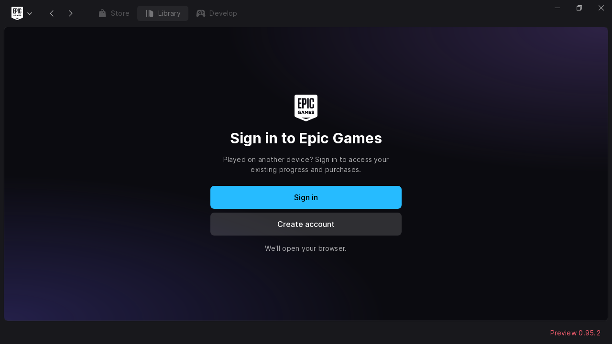

# Epic Games Launcher Flatpak

Manifiesto no oficial para el nuevo [Epic Games Launcher Preview para Linux](https://launcher.epicgames.com/). Convierte el AppImage oficial de la versión **0.95.2+gfa9ad49** en una aplicación Flatpak con el identificador `com.epicgames.EpicGamesLauncher`.

Sigue el patrón de LMStudio-Flatpak y MusicPresence-Flatpak: el [AppImage se descarga como `extra-data`](https://docs.flatpak.org/en/latest/module-sources.html#extra-data) durante la instalación y se verifica con su tamaño y SHA-256. El repositorio guarda el manifiesto, los scripts, el icono y los metadatos; el binario de Epic se obtiene de su servidor.

Usa `org.gnome.Platform//51` y `org.gnome.Sdk//51` para GTK 3 y WebKitGTK 4.1. Compila libayatana-appindicator 0.6.1 y libdbusmenu para la bandeja del sistema; las fuentes están fijadas en `modules/libayatana-appindicator.json`. Solo admite **x86_64**, la arquitectura del AppImage publicado por Epic.

## Compilar e instalar para tu usuario

Instala Flatpak y añade Flathub para tu usuario si todavía no lo tienes:

```bash
flatpak remote-add --user --if-not-exists flathub https://flathub.org/repo/flathub.flatpakrepo
flatpak install --user flathub org.flatpak.Builder
./build.sh
```

`build.sh` usa `flatpak-builder` si está disponible y, en caso contrario, el de `org.flatpak.Builder`. Instala las dependencias que falten, compila el extractor y los archivos de empaquetado, exporta un repositorio OSTree a `repo/` e instala la aplicación para tu usuario desde el remoto local `epic-games-launcher-local`. La instalación se ejecuta con el Flatpak del host para que `extra-data` pueda crear su sandbox de extracción. Los archivos de compilación quedan en `builddir/`.

## Ejecutar

```bash
flatpak run com.epicgames.EpicGamesLauncher
```

La entrada del menú registra el protocolo `com.epicgames.launcher://` del launcher. El wrapper conserva los argumentos para los enlaces de inicio de sesión. En NVIDIA activa `WEBKIT_DISABLE_DMABUF_RENDERER=1` para evitar el cierre por error de protocolo de Wayland observado con este Preview. Puedes definir esa variable explícitamente para cambiar el comportamiento.

Los datos propios del Flatpak quedan en `~/.var/app/com.epicgames.EpicGamesLauncher/`. El manifiesto permite instalar juegos en `~/Games` y acceder a unidades montadas en `/run/media`, `/media` y `/mnt`. Para usar otra biblioteca, concede acceso a su carpeta:

```bash
flatpak override --user --filesystem=/ruta/a/tu/biblioteca com.epicgames.EpicGamesLauncher
```

El paquete contiene el launcher nativo. Los juegos de Windows pueden necesitar una capa de compatibilidad, según [las indicaciones de Epic](https://launcher.epicgames.com/#faq-linux).

## Crear un paquete instalable

Después de compilar:

```bash
flatpak build-bundle repo epic-games-launcher-0.95.2-x86_64.flatpak com.epicgames.EpicGamesLauncher stable
flatpak install --user ./epic-games-launcher-0.95.2-x86_64.flatpak
```

El bundle conserva la referencia a `extra-data`; la instalación necesita conexión para descargar el AppImage de Epic.

## Actualizar el AppImage

Descarga la versión que publica la web oficial y anota la URL final del servidor:

```bash
mkdir -p .cache
curl --fail --location \
  --output .cache/EpicGamesLauncher-x86_64.AppImage \
  --write-out '%{url_effective}\n' \
  https://launcher-public-service-prod06.ol.epicgames.com/launcher/api/installer/download/EpicGamesLauncher-x86_64.AppImage
sha256sum .cache/EpicGamesLauncher-x86_64.AppImage
stat --format=%s .cache/EpicGamesLauncher-x86_64.AppImage
```

Actualiza `url`, `sha256` y `size` en `com.epicgames.EpicGamesLauncher.yml`, y la versión y fecha en `com.epicgames.EpicGamesLauncher.metainfo.xml`. Usa la URL final que incluye la versión, para que una nueva publicación de Epic no cambie el archivo esperado por el manifiesto. Revisa también el icono y la estructura interna cuando cambie el empaquetado de upstream.

`apply_extra.sh` extrae SquashFS con soporte Zstandard. Conserva el ejecutable, el SDK EOS y `ThirdPartyNotices.txt`, y usa las bibliotecas GTK, GLib y WebKit del runtime GNOME. El ejecutable y sus recursos quedan en `/app/extra/epic-games-launcher/`.

Las actualizaciones de este paquete se distribuyen mediante Flatpak. Tras cambiar la versión en el manifiesto, vuelve a ejecutar `./build.sh`.

## Validación local

La versión 0.95.2+gfa9ad49 se compiló e instaló en x86_64 con GNOME 51 el 14 de octubre de 2026. Se comprobaron la sintaxis de los scripts, los metadatos AppStream, la entrada de escritorio, las bibliotecas enlazadas y la conservación de los avisos de terceros. La extracción de `extra-data` y el registro de la bandeja terminaron correctamente.

El arranque y la pantalla de inicio de sesión se verificaron en Wayland dentro de Cage, con una salida virtual de 1280 × 720. Para abrir una sesión de prueba anidada:

```bash
WLR_BACKENDS=wayland cage -d -- flatpak run --user com.epicgames.EpicGamesLauncher
```

El launcher debe estar cerrado antes de iniciar la prueba para que su instancia única se abra dentro de Cage.



El inicio de sesión, la persistencia de credenciales y la descarga y ejecución de juegos quedan sin probar, al igual que los equipos sin NVIDIA.

El Preview emite el aviso `NoDefaultStore` al inicializar las credenciales y continúa con DPoP desactivado para esa sesión. Según la [definición del error en keyring-core](https://docs.rs/keyring-core/latest/src/keyring_core/error.rs.html), el programa no ha configurado un almacén predeterminado. El aviso queda pendiente; este manifiesto no modifica el binario de Epic.

## Licencias

Los scripts y archivos de empaquetado se distribuyen bajo MIT, y los metadatos AppStream bajo CC0-1.0. El launcher, el SDK EOS y el icono conservan las licencias de Epic y de sus respectivos autores. La extracción mantiene los avisos de terceros incluidos por Epic. Las recetas y los parches de intltool y libdbusmenu proceden de [flathub/shared-modules](https://github.com/flathub/shared-modules/tree/master/libayatana-appindicator) y conservan sus atribuciones. Las dependencias compiladas mantienen sus propias licencias.
